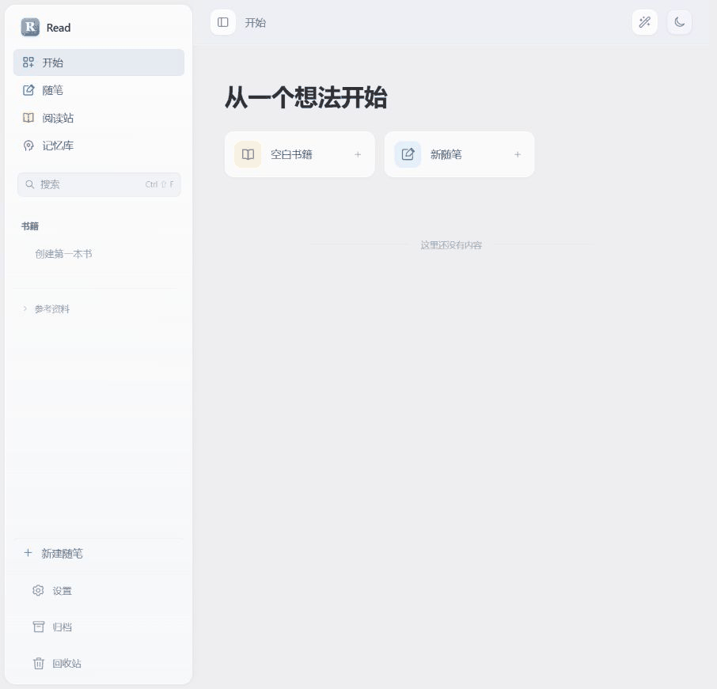

# Read

随手记录，组织阅读，让知识保持新鲜。

[在线体验](https://sznine.github.io/devbook-demo/) · [配置说明](immersive-review/docs/CONFIGURATION.md) · [开发说明](immersive-review/README.md)



- **随笔**：Markdown 即时编辑、引用、全局搜索。
- **阅读站**：用书籍与章节组织内容，保留独立随笔。
- **记忆库**：根据阅读活动和预计保持率展示内容的新鲜度。
- **智能助手**：自选模型、上下文与回答风格，支持连续对话。

## 本地部署

启动 Docker Desktop 或 Docker Engine，在项目根目录运行：

```sh
docker compose up -d --build
```

打开 [http://127.0.0.1:5174](http://127.0.0.1:5174)。首次构建需要联网。

在“设置”中调整外观、编辑偏好、导出目录和 AI 服务。需要更换端口等部署配置时，复制 `.env.example` 为 `.env`，修改后重新运行启动命令。

```sh
docker compose logs --tail=50   # 查看日志
docker compose down            # 停止并保留配置
docker compose up -d --build    # 更新后重建
```

## 数据

笔记、学习记录和对话保存在当前浏览器；API 配置保存在 Docker 数据卷。设置中的“文件”可导出 Markdown 或 JSON 数据副本，支持选择本机保存文件夹。保持相同的访问地址，避免切换到另一份浏览器存储。

在线体验不连接 AI，内容仅保存于当前浏览器。使用 AI 请本地部署；密钥由服务端保存，不包含在数据导出中。默认服务仅供本机访问，公网部署需自行配置身份验证。

## 开发

需要 Node.js 22.14+。

```sh
cd immersive-review
npm ci
npm run dev
```

验证：`npm test`、`npm run build`。更多信息见[开发说明](immersive-review/README.md)。
