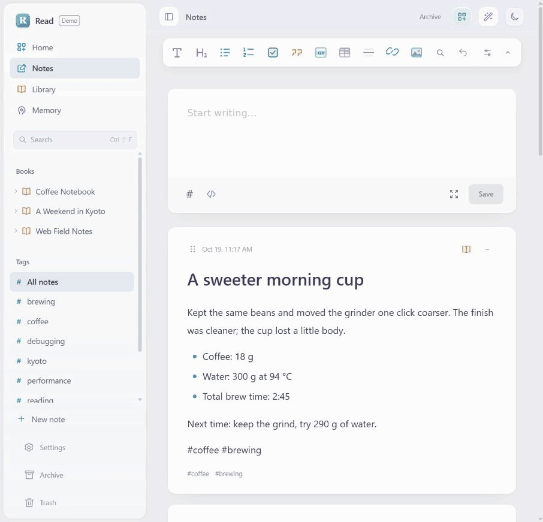
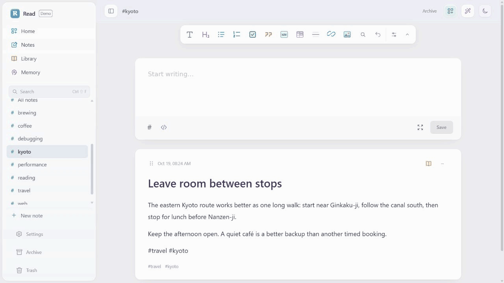
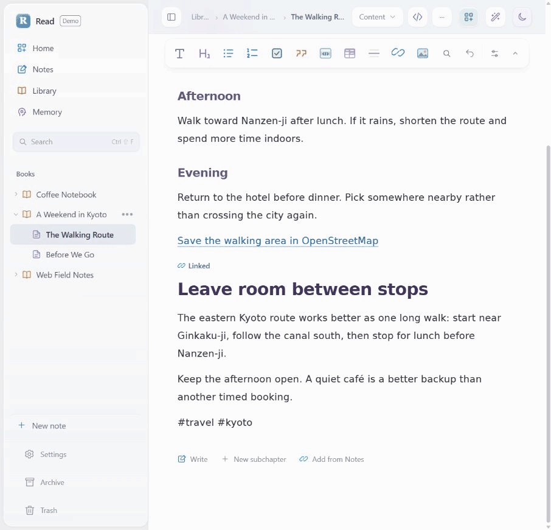

# Read

A place for quick notes, growing books, and focused reading.

[Configuration](immersive-review/docs/CONFIGURATION.md) · [Development](immersive-review/README.md)

## Capture

Write a brewing observation, a reading note, or a weekend checklist in Markdown.



## Organize

Turn related notes into books and chapters. Move, rename, and reorder them as your ideas develop.



## Read

Keep summaries, chapter navigation, and content in one reading space. Search across your library and revisit notes through Memory.



## Run locally

With Docker running, from the project root:

```sh
docker compose up -d --build
```

Open [localhost:5174](http://127.0.0.1:5174). The first build needs an internet connection.

Settings include language, appearance, editing preferences, a local export folder, and optional model connections. English is the default; Simplified Chinese is also available.

For ports, storage, exports, and service configuration, see [Configuration](immersive-review/docs/CONFIGURATION.md).

## Develop

Requires Node.js 22.14 or later.

```sh
cd immersive-review
npm ci
npm run dev
```

Run `npm test` and `npm run build` before submitting changes.
